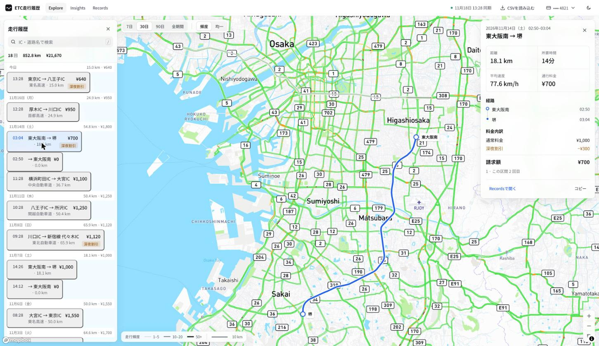
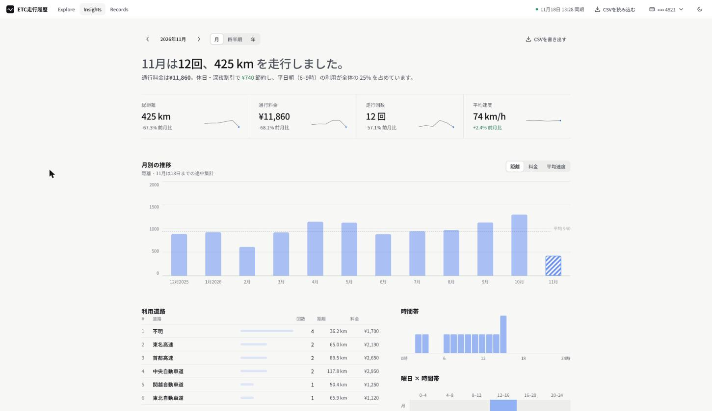
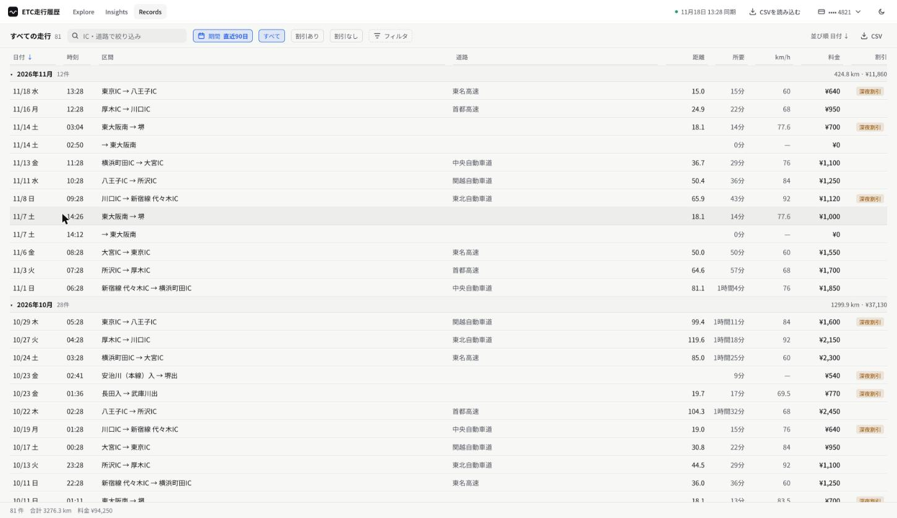

# ETC走行ダッシュボード

ETC利用照会サービスの利用明細をローカルに取り込み、走行履歴をダッシュボードとして可視化するChrome拡張機能です。

データは自分のブラウザ内(IndexedDB)にのみ保存されます。サーバーには一切送信されません(地図タイル・経路検索を除く。詳細は下記「地図について」参照)。

## スクリーンショット

### Explore — 実際の道路にトレースした走行ルート地図



区間をクリックすると、IC座標からMapbox Directionsで実道路にスナップした経路・距離・所要時間・料金内訳が表示されます。

### Insights — 月次サマリーと各種ランキング



KPI(距離・料金・走行回数・平均速度)、月別推移チャート、利用道路ランキング、時間帯別ヒストグラムなど。

### Records — 全走行履歴の一覧・検索



ソート可能なテーブルで全履歴を検索・絞り込み。行を選択すると詳細パネルが開きます。

## 主な機能

- ETC利用照会サービスの「明細CSV」を取り込み、走行履歴をローカルDB(IndexedDB)に保存
- IC名から実際の緯度経度を引き、Mapbox GL + Mapbox Directionsで実際の道路に沿ったルートを地図に描画
- 月次KPI、推移チャート、道路別・時間帯別の集計(Insights)
- 検索・並び替え・フィルタ可能な全履歴テーブル(Records)
- ライト/ダークテーマ対応

## データの取り込み方法

ETC利用照会サービスの「明細CSV」出力はブラウザのトリガードダウンロード(ポップアップ経由)になっており、拡張機能から安全に自動化できないことが分かっています(詳細は`docs/site-notes.md`)。そのため現状は次の手順で取り込みます。

1. [ETC利用照会サービス](https://www.etc-meisai.jp/)にログインし、「検索条件の指定」で期間を指定して検索する(一度に過去15ヶ月分をまとめて検索可能)
2. 「全頁選択」→「明細CSV」でCSVをダウンロードする
3. ダッシュボードのヘッダーにある「CSVを読み込む」から、ダウンロードしたCSVを選択する

## セットアップ(開発者向け)

```bash
npm install
cp .env.example .env   # VITE_MAPBOX_TOKEN に自分のMapboxトークンを設定
npm run dev            # ブラウザ単体でダッシュボードUIを確認(ダミーデータ)
```

### 拡張機能として読み込む

```bash
npm run build
```

1. Chromeで `chrome://extensions` を開く
2. 右上の「デベロッパーモード」をON
3. 「パッケージ化されていない拡張機能を読み込む」→ 生成された `dist/` フォルダを選択

### テスト・型チェック

```bash
npm run test       # vitest
npm run typecheck   # tsc --noEmit
```

## 地図について

- ベース地図・経路検索には[Mapbox](https://www.mapbox.com/)を使用しています。自分のアクセストークンを`.env`の`VITE_MAPBOX_TOKEN`に設定してください(未設定でも動作しますが、ルートは直線表示にフォールバックします)。
- IC名→緯度経度の対応表は`src/shared/ic-coordinates.ts`。日本語版Wikipediaの各IC/JCT記事の座標で検証済みですが、座標が確認できなかった一部の名前(本線料金所など)は未収録です。
- 走行ルートの線はMapbox Directions(driving)による実際の道路形状へのスナップで、区間ごとに1回だけAPIを呼び、結果はローカル(IndexedDB)にキャッシュします。
- 表示されている距離・速度の数値自体は、IC座標間の直線距離(Haversine)に基づく概算です(地図上の線のトレースとは別計算)。

## 技術構成

- Vite + `@crxjs/vite-plugin` + React 18 + TypeScript (strict)
- Dexie (IndexedDB)
- React Router
- Mapbox GL JS
- Vitest

## 開発ドキュメント

実サイト調査の詳細や既知の制約は `docs/site-notes.md`、作業ログは `docs/progress.md` を参照してください。
